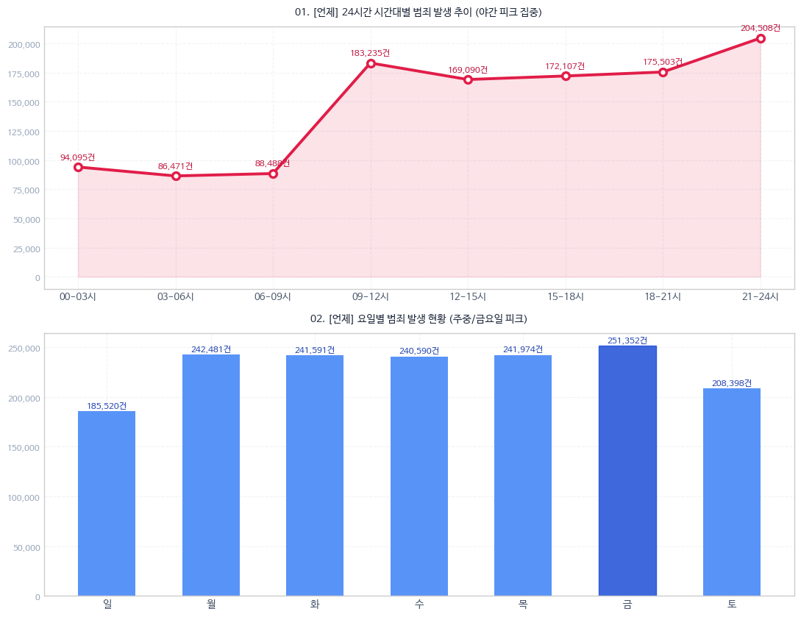
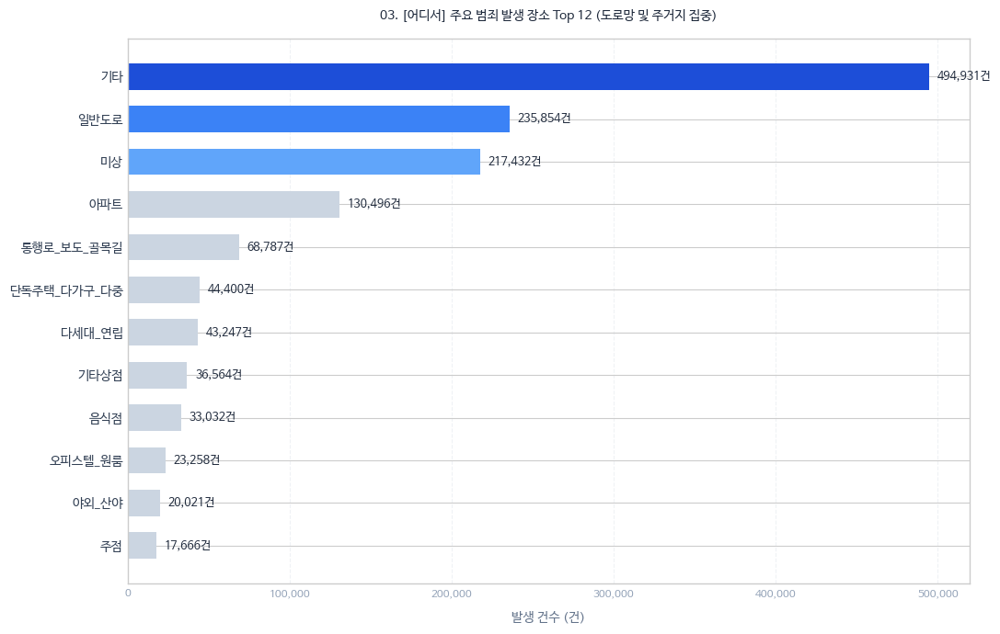
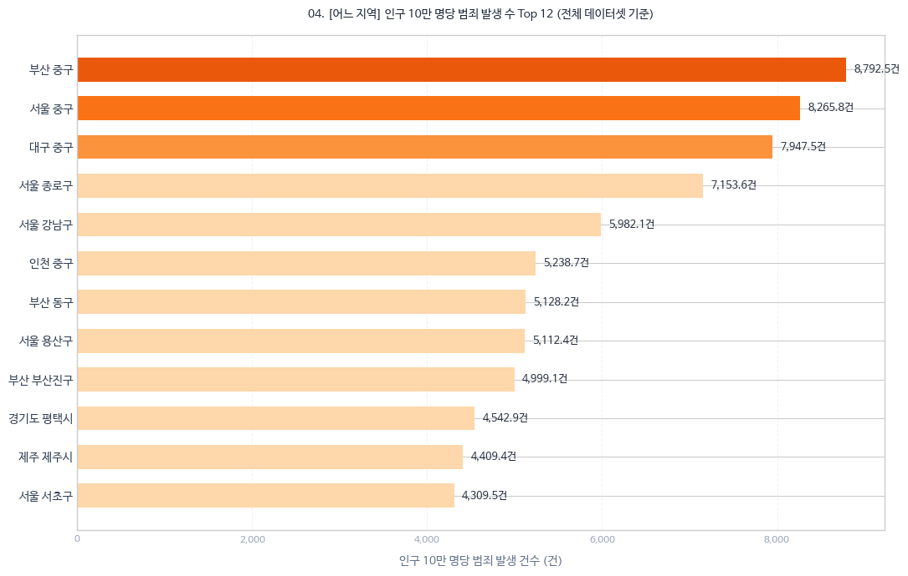

# 경찰청 범죄 통계 시각화 & 웹사이트 보고서
**공공데이터 기반 범죄 발생 패턴 분석**

---

## 1. 공공데이터 설명

### 1.1 데이터 개요 및 규모
- **총 데이터셋**: 3개 (`df_time`, `df_place`, `df_region`)
- **범죄 분류 기준**: 15개 범죄 대분류 및 38개 범죄 중분류 (38개 행 기준 동일)
- **데이터 특징**:
  - **결측치**: 0개 (완전 데이터)
  - 세 데이터의 집계 연도가 다르므로 인과관계가 아닌 **독립적 패턴 비교용**으로 활용함.

### 1.2 범죄 분류 체계
- **범죄 대분류 (15개)**: 강력범죄, 절도범죄, 폭력범죄, 지능범죄, 풍속범죄, 특별경제범죄, 마약범죄, 보건범죄, 환경범죄, 교통범죄, 노동범죄, 안보범죄, 선거범죄, 병역범죄, 기타범죄
- **범죄 중분류 (38개)**: 살인기수, 살인미수등, 강도, 강간, 유사강간, 강제추행, 기타 강간 강제추행등, 방화, 절도, 상해, 폭행, 체포 감금, 협박, 약취 유인, 폭력행위등, 공갈, 손괴, 직무유기, 직권남용, 증수뢰, 통화, 문서 인장, 유가증권인지, 사기, 횡령, 배임, 성풍속범죄, 도박범죄, 특별경제범죄, 마약범죄, 보건범죄, 환경범죄, 교통범죄, 노동범죄, 안보범죄, 선거범죄, 병역범죄, 기타범죄

---

### 1.3 세부 데이터셋 명세

#### ① 경찰청_범죄 발생 시간대 및 요일
> 유형별 범죄율을 시간대 및 요일 기준으로 구분한 데이터

- **데이터 출처**: [공공데이터포털](https://www.data.go.kr/data/3074459/fileData.do)
- **분석 기간**: ~2019.12.31
- **규모**: 38행 × 189열 (총 3,223,812건)
- **분석 범위**:
  - **시간대 (9개 구간)**: 00시-02시59분, 03시-05시59분, 06시-08시59분, 09시-11시59분, 12시-14시59분, 15시-17시59분, 18시-20시59분, 21시-23시59분, 미상
  - **요일 (8개)**: 일, 월, 화, 수, 목, 금, 토, 미상
- **특징**: 24시간 흐름(3시간 단위) 및 주중/주말 패턴 파악 가능

#### ② 경찰청_범죄 발생 장소별 통계
> 유형별 범죄율을 발생 장소 기준으로 구분한 데이터

- **데이터 출처**: [공공데이터포털](https://www.data.go.kr/data/3074463/fileData.do)
- **분석 기간**: ~2025.12.31
- **규모**: 38행 × 64열 (총 1,599,695건)
- **분석 범위**: 장소 항목 64개 세분화 (단독주택, 아파트, 일반도로, 골목길, 편의점, 음식점, 주점 등)
- **특징**: 상권 및 주거/교통 시설별 패턴 파악 가능

#### ③ 경찰청_범죄 발생 지역별 통계
> 유형별 범죄율을 지역(시·군·구) 기준으로 구분한 데이터

- **데이터 출처**: [공공데이터포털](https://www.data.go.kr/data/3074462/fileData.do)
- **분석 기간**: ~2025.12.31
- **규모**: 38행 × 249열 (총 1,583,108건)
- **분석 범위**: 전국 주요 시·군·구 (서울 25, 부산 16, 대구 9, 인천 10, 광주 5, 대전 5, 울산 5, 세종 1, 경기 31, 강원 18, 충북 11, 충남 15, 전북 14, 전남 22, 경북 22, 경남 18, 제주 2, 외국 17 등)
- **특징**: 인접 지역별 및 행정구역별 범죄 발생 수 파악 가능

---

## 2. 데이터 시각화 분석

### 2.1 시간대 및 요일 분석

- **시간대 분석 (선 그래프)**: 
  - 시간 순서에 따른 변화 흐름 파악에 적합.
  - 야간 시간대(21~24시)에 범죄 발생이 비교적 집중되는 경향을 보임.
- **요일별 분석 (막대 그래프)**: 
  - 항목별 크기 비교에 적합.
  - 금요일에 범죄 발생률이 상대적으로 높은 피크를 보임.
- **시사점**: 특정 시간대와 요일에 집중되는 경향은 있으나, 요일 간/시간대 간 전반적인 차이가 아주 극단적이지는 않으므로 **시간과 요일에 관계없이 범죄는 상시 발생**함을 시사함.

---

### 2.2 장소 분석 (Top 12)

- **시각화 방식**: 범주형 순위 비교에 최적화된 **가로 정렬 막대 그래프**
- **주요 장소**: 기타, 일반도로, 미상, 아파트, 통행로·보도·골목길, 단독주택 등 순
- **시사점**: 도로망 및 주거지역에 범죄가 비교적 집중되는 편이나, 상점, 음식점, 야외 등 다양한 장소에서 두루 일어남을 통해 **범죄는 장소를 가리지 않고 일어남**을 설명함.

---

### 2.3 지역 분석 (Top 12 - 인구 10만 명당)

- **시각화 방식**: 지역 간 발생 규모 비교를 위한 **가로 정렬 막대 그래프**
- **주요 지역**: 부산 중구, 서울 중구, 대구 중구, 서울 종로구, 서울 강남구 등
- **시사점**: Top 3 지역이 차지하는 비율은 전체의 약 2.26% 수준임. 상위 지역이라 하더라도 다른 지역과의 범죄 발생 수 차이가 절대적이지 않으며, **범죄는 특정 지역에만 국한되지 않고 어느 지역에서나 발생**함을 의미함.

---

## 3. 결론 및 가치 제언

### 💡 3개 그래프를 통해 전달하고자 하는 메시지
3개의 그래프를 종합해 보면 한 가지 공통된 사실을 알 수 있습니다. **범죄는 언제, 어디서, 어떤 장소에서든 발생할 수 있다는 점**입니다.

물론 지역, 장소, 시간대에 따라 범죄 발생 건수에 차이가 있는 것은 사실입니다. 하지만 요소별 범죄 발생 건수의 차이가 "A 요소가 B 요소보다 범죄 발생률이 무조건 높다"고 단정할 만큼 절대적이지는 않습니다.

특히 범죄는 유형에 따라 발생 원인, 수법, 피해 정도의 차이가 매우 큽니다. 따라서 단순히 '범죄 수'라는 단일 기준만으로 위험도를 판단하기에는 한계가 있습니다.

이에 따라 본 서비스는 사용자가 자신의 상황과 목적에 맞춰 필요한 정보를 능동적으로 판단할 수 있도록 객관적인 데이터를 제공하고자 합니다.

### 💎 본 프로젝트가 사용자에게 제공하는 가치
1. **범죄 유형별 필터링 기능**: 세분화된 맞춤형 통계 결과를 제공합니다.
2. **데이터 종합 분석 결과**: 특정 시간·장소·지역에서 왜 범죄 발생률이 높은지 그 배경과 요인 간의 관계를 직관적으로 이해할 수 있도록 돕습니다.

결과적으로 사용자는 자신의 목적과 상황에 맞게 범죄 유형별 빈발 시간, 장소, 지역을 다각도로 분석하고 판단하여, **스스로 위험을 예방하고 대처할 수 있는 정보 기반의 선택권**을 갖게 됩니다.

---

## 4. 사이트 설명 및 서비스 안내

### 🌐 사이트 정보
- **웹사이트 주소**: [https://hihibang.github.io/Police-crime-dashboard/](https://hihibang.github.io/Police-crime-dashboard/)

### 🛠️ 주요 기능
1. **범죄 유형별 필터링**: Dropdown 선택을 통해 범죄 유형별 분포 및 건수 세분화 확인
2. **통계 그래프 대시보드**: 2×2 그리드 기반의 시간대/요일/장소/지역(지도) 시각화 제공
3. **데이터 종합 해석 (인사이트)**: 선택한 범죄 유형에 따라 각 요소가 가지는 의미와 데이터 해석을 자동으로 생성
4. **원본 데이터 세트 다운로드**: 분석에 사용된 원본 CSV 데이터셋 제공

---
*참고사항: 본 프로젝트에 사용된 데이터셋은 공공데이터포털 출처 링크 및 제공된 `data.zip` / `index.html` 파일을 통해 원본 확인 및 직접 시연이 가능합니다.*